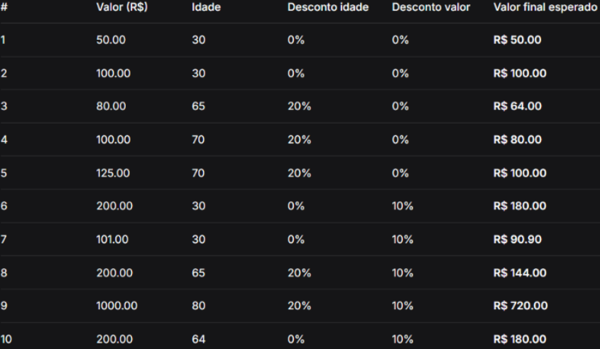

# PDV com Descontos — Nível 1

## 1. O que o código faz?

Este projeto é um sistema simples de Ponto de Venda (PDV) desenvolvido em Python. Ele recebe o valor de uma compra e a idade do cliente, calcula os descontos aplicáveis, apresenta o valor final e registra as compras realizadas. Ao encerrar o programa, exibe um resumo com a quantidade de compras, o total bruto, o total de descontos concedidos e o valor final das vendas.

## 2. Como o código funciona?

O programa funciona seguindo estas etapas:

1. Solicita o valor da compra. O usuário pode digitar `0` para encerrar o programa.
2. Verifica se o valor informado é negativo. Se for, exibe uma mensagem de aviso e solicita uma nova entrada.
3. Solicita a idade do cliente.
4. Verifica se o cliente tem 65 anos ou mais. Se tiver, aplica um desconto de 20% sobre o valor da compra.
5. Verifica se o valor após o desconto por idade é maior que R$ 100,00. Se for, aplica mais 10% de desconto sobre esse valor.
6. Calcula e exibe o valor final da compra.
7. Armazena os dados de cada compra em uma lista usando o método `.append()`.
8. Quando o usuário encerra o programa, calcula e apresenta o resumo das compras registradas.

## 3. Como executar o programa?

É necessário ter o Python instalado no computador.

No terminal, entre na pasta `nivel_1` e execute o comando:

```bash
python pdv.py
```

**Observação:** o arquivo Python precisa estar nomeado como `pdv.py` para que esse comando funcione. Se o nome do arquivo for diferente, ajuste o comando.

## 4. Tabela de casos de teste


## 5. Resumo final

Ao encerrar o programa, o sistema apresenta:

- **Quantidade de compras:** número de compras registradas.
- **Total bruto:** soma dos valores originais das compras.
- **Total de descontos:** soma dos descontos concedidos.
- **Total final:** soma dos valores pagos após os descontos. 